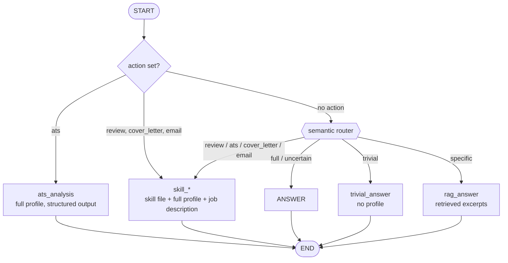

# job-chat

A private assistant for job applications. It answers questions about your background, drafts
interview answers, scores your profile against a job description, and writes cover letters —
grounded only in your own career documents.

## Setup

**1. Create the environment**

Python 3.13 is what CI runs on; 3.11+ works.

```bash
python -m venv .venv
```

Activate it — Windows:

```powershell
.venv\Scripts\activate
```

macOS / Linux:

```bash
source .venv/bin/activate
```

Then:

```bash
pip install -r requirements.txt
```

**2. Configure `.env`** in the project root:

```ini
OPENROUTER_API_KEY=...            # required
CANDIDATE_NAME=Your Name        # used in the system prompt

# Optional — Langfuse tracing. Tracing turns on only when both keys are present.
LANGFUSE_PUBLIC_KEY=pk-lf-...
LANGFUSE_SECRET_KEY=sk-lf-...
LANGFUSE_HOST=https://us.cloud.langfuse.com
```

| Variable | Default | Purpose |
|---|---|---|
| `OPENROUTER_API_KEY` | — | Required. Startup fails without it. |
| `CANDIDATE_NAME` | `the candidate` | Your name, used in the system prompt. |
| `DATA_DIR` | `data` | Folder holding your profile documents. Relative paths resolve against the project root. |
| `OPENROUTER_MODEL` | `nvidia/nemotron-3-nano-omni-30b-a3b-reasoning:free` | OpenRouter model id. |
| `LLM_TEMPERATURE` | `0.0` | Sampling temperature. |
| `LLM_MAX_TOKENS` | `3000` | Response cap for ordinary chat. See the token budget note below. |
| `SKILL_MAX_TOKENS` | `6500` | Response cap for the four skills (review, ATS, cover letter, email). |
| `LLM_DRAFTING_TEMPERATURE` | `0.4` | Temperature for cover-letter drafting only. |
| `MAX_HISTORY_TURNS` | `10` | Turns replayed to the model per request. |
| `EMBEDDING_MODEL` | `sentence-transformers/all-MiniLM-L6-v2` | Routing and retrieval embeddings, run through fastembed (ONNX, no torch). Downloaded on first run. |
| `RETRIEVAL_TOP_K` | `5` | Excerpts retrieved for a narrow question. |
| `CHECKPOINT_DB` | `checkpoints.sqlite` | Where conversation threads persist. |
| `LANGFUSE_PUBLIC_KEY` / `LANGFUSE_SECRET_KEY` | — | Enable tracing when both are set. |
| `LANGFUSE_HOST` (alias: `LANGFUSE_BASE_URL`) | `https://cloud.langfuse.com` | Langfuse region. Use `https://us.cloud.langfuse.com` if your keys are US. |

**3. Add your documents.** Put your resume, project write-ups, and any other career documents
in `data/`. PDFs must be converted to Markdown first — the app reads only `.md`:

```bash
pip install -r requirements-ingest.txt   # docling, heavy; needed only for this step
python pdf_2_markdown_converter.py
```

The converter reads and writes `data/` directly; it does not honour `DATA_DIR`. If you point
`DATA_DIR` elsewhere, convert in `data/` first and move the `.md` files across.

Startup fails if the directory is missing or holds no `.md` file, so do this before step 4.

**4. Run**

```bash
python app.py                   # http://localhost:7860
```

Paste a job description into the left panel, then chat or use the four skill buttons (Resume review, ATS score & keywords, Cover letter, Application email). Select
**Stop** beside the message box to cancel a response that's being generated; any text already
received remains in the conversation.

## Project structure

```
job-chat/
├── app.py                       # Gradio UI and event wiring — the entry point
├── graph.py                     # LangGraph state graph, routing, LLM construction
├── prompts.py                   # Chat and skill system prompts
├── skills.py                    # Skill registry: buttons, labels, loader
├── skills/                      # One markdown file per skill; edit these to change behaviour
├── router.py                    # Semantic router: trivial / specific / full / the four skills
├── retrieval.py                 # Chunking and similarity search over the profile
├── embeddings.py                # fastembed wrapper
├── ats.py                       # ATS schema and score calculation
├── dataloader.py                # Loads and concatenates the Markdown profile documents
├── config.py                    # Environment settings with validation
├── observability.py             # Langfuse tracing (optional, fails open)
├── pdf_2_markdown_converter.py  # One-off: PDF -> Markdown
├── data/                        # Your documents (gitignored)
├── tests/                       # Unit tests; no API calls
├── .github/workflows/tests.yml  # CI: runs the suite on push and pull request
├── requirements.txt             # Runtime
├── requirements-ingest.txt      # PDF conversion only
└── requirements-dev.txt         # Tests (install on top of requirements.txt)
```

## Graph structure

A skill button routes on its `action` straight to that skill. Free-form chat is classified by a
semantic router, which either picks a skill (when the request clearly asks for one) or decides how
much of your profile the question actually needs.



**State**

| Field | Purpose |
|---|---|
| `messages` | Conversation, appended via `add_messages`. |
| `job_description` | The pasted target role. |
| `action` | `review`, `ats`, `cover_letter`, `email`, or empty for free chat. |

**Nodes**

| Node | Context sent | Used for |
|---|---|---|
| `answer` | Full profile + job description | Any broad question |
| `skill_review`, `skill_cover_letter`, `skill_email` | Skill file + full profile + job description | The matching button, or a chat request the router recognises. Output capped at `SKILL_MAX_TOKENS`. |
| `rag_answer` | Top `RETRIEVAL_TOP_K` excerpts | Narrow factual questions |
| `trivial_answer` | None | Greetings and pleasantries |
| `ats_analysis` | `analyze-ats-keywords.md` + full profile + job description | The ATS button, or a chat request the router recognises |

All three chat nodes replay only the last `MAX_HISTORY_TURNS` turns. Older turns stay in the
checkpoint but are not resent, so cost per turn stays flat however long the conversation runs.

`ats_analysis` asks the model only to classify each job-description keyword as matched or missing.
The percentage is computed in Python from the list lengths, so the score cannot contradict the
lists it is derived from.

**Routing rules.** Every skill button bypasses the router and receives the full profile: a
retrieval miss inside an ATS score or a resume review would silently drop real evidence. For free
chat, the router compares the question against the centroid of reference examples per route
(`router.py`) and falls back to the full profile whenever the best match is weak or close to the
runner-up. The asymmetry is deliberate — routing a greeting to the full profile only wastes
tokens, while routing a real question away from it produces a confident answer with no evidence
behind it.

**Measured cost per request** (this profile, one narrow question):

| Route | Approximate prompt tokens | Saving |
|---|---|---|
| `answer` | 4,110 | — |
| `rag_answer` | 1,028 | 75% |
| `trivial_answer` | 195 | 95% |

**Persistence.** A SQLite checkpointer keeps each thread on disk, so conversations survive a
restart. "Reset conversation" starts a new thread; the previous one is retained.

## Tests

```bash
pip install -r requirements-dev.txt      # on top of requirements.txt
python -m pytest tests/ -q
```

Unit tests only — no API calls, no keys needed. They cover the ATS score arithmetic, config
validation, document loading, chunking and retrieval, semantic routing, node selection, history
trimming, temperature selection, and prompt templating. `tests/test_isolation.py` asserts the
suite never touches your real credentials or your `data/` documents. CI runs the same command on
every push to `main` and every pull request.

## Token budget

`LLM_MAX_TOKENS` defaults to 3,000 to cap the response size. A full-profile request also sends
your profile (~3,900 tokens), the job description, and recent conversation history. OpenRouter
model context windows and account limits vary, so shorten the job description or lower
`LLM_MAX_TOKENS` if a request exceeds the model's limits.
